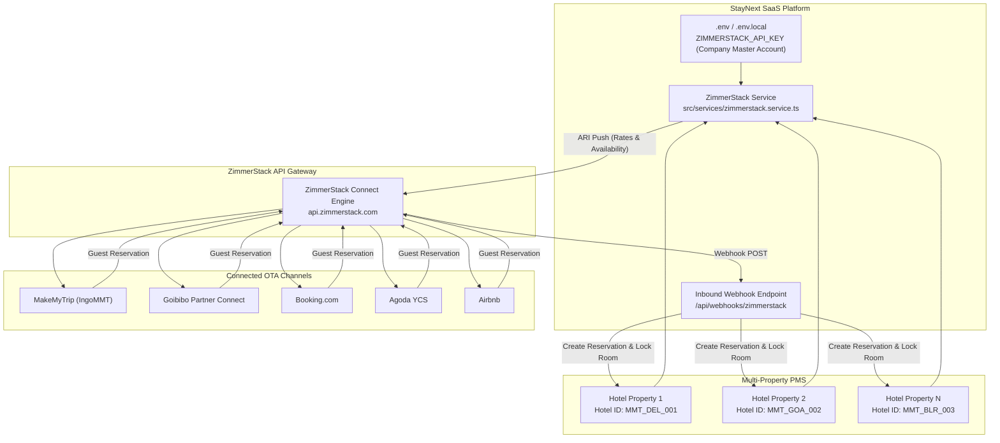

# StayNext Channel Manager & OTA 2-Way Sync (ZimmerStack API)

## Executive Summary
StayNext PMS includes a native **2-Way OTA Channel Manager** powered by the **ZimmerStack Connect API**. This feature provides instant two-way inventory and rate synchronization between your StayNext property management system and major domestic and international Online Travel Agencies (OTAs), notably **MakeMyTrip (IngoMMT)**, **Goibibo**, **Booking.com**, **Agoda**, and **Airbnb**.

---

## 1. Architecture & Multi-Property Platform Model



### Key Architectural Advantages
1. **Central Company Master Account**:
   - The platform Master API Key, Secret, and Environment reside securely in `.env` / `.env.local`.
   - Your company owns the ZimmerStack master license; individual hotels do not need to register separate developer accounts or enter master API keys.
2. **Per-Property Hotel ID Mapping**:
   - Each property is assigned a unique `hotelId` (e.g. `MMT_DEL_001` or auto-derived from the property code).
   - ZimmerStack routes reservations and room updates based on this Hotel ID.
3. **Optional Property Override**:
   - If an enterprise hotel has its own independent ZimmerStack license, they can optionally specify a dedicated API key in the UI.

---

## 2. Supported OTA Channels

| Channel | Platform Code | Category | Sync Protocol | Features |
| :--- | :--- | :--- | :--- | :--- |
| **MakeMyTrip** | `MMT-API` | Indian OTA | Instant 2-way | IngoMMT live ARI push, real-time booking ingestion, rate parity |
| **Goibibo** | `GOIBIBO-API` | Indian OTA | Instant 2-way | High-volume domestic room lock, promo sync, instant confirmation |
| **Booking.com** | `BKG-API` | Global OTA | Instant 2-way | XML connectivity, modification & cancellation sync |
| **Agoda** | `AGD-API` | Global OTA | Instant 2-way | YCS partner API, multi-currency conversion, APAC guest sync |
| **Airbnb** | `ABNB-API` | Vacation Rental | Instant 2-way | Boutique suites, calendar lock, host availability sync |
| **Expedia** | `EXP-API` | Global OTA | Hourly/Realtime | Expedia Partner Central, Hotels.com syndication |

---

## 3. How the 2-Way Synchronization Works

### A. Outbound Push: Rates, Availability & Inventory (ARI)
Whenever room rates are updated or a reservation is created, checked-in, or canceled inside StayNext:
1. StayNext computes accurate inventory for each room type:
   $$\text{Available Rooms} = \max(0, \text{Total Rooms} - \text{Active Reservations})$$
2. Pushes the ARI payload to ZimmerStack:
   `PUT /api/v1/connect-api/v1/availability`
3. ZimmerStack instantly updates MakeMyTrip, Goibibo, Booking.com, and Agoda simultaneously, preventing overbooking.

### B. Inbound Webhook: Automatic Reservation Ingestion
When a guest places a booking on MakeMyTrip or Goibibo:
1. ZimmerStack delivers an instant `POST` payload to:
   `https://yourdomain.com/api/webhooks/zimmerstack`
2. StayNext automatically:
   - Validates the request signature and identifies the property by `hotelId`.
   - Creates or links the guest profile in `guests` table.
   - Creates a confirmed reservation in `reservations` table with the OTA booking reference, guest contact details, room type, and paid amount.
   - Decrements PMS room inventory and displays the new booking in the Front Desk and Calendar.

---

## 4. Software UI Pages & Navigation

### 1. Channel Manager Dashboard
- **Route**: `/booking-engine/channels`
- **Features**:
  - **Company Master Account Badge**: Visual banner indicating that your company's master credentials from `.env` are active.
  - **Sync All Channels**: One-click button to push live inventory and rates across all connected OTAs.
  - **Channel Cards**: Individual cards for MakeMyTrip, Goibibo, Booking.com, Agoda, and Airbnb with live sync status, active room type count, and single-channel sync button.
  - **Webhook URL Display**: Copyable inbound webhook link for ZimmerStack configuration.
  - **Configuration Modal**: Interface to inspect credentials and update the property's `hotelId`.

### 2. Integrations Settings
- **Route**: `/settings/integrations`
- **Features**:
  - Unified interface with tabs for **ZimmerStack (OTAs)**, **WhatsApp (Meta Cloud API)**, and **Media (ImageKit CDN)**.
  - Test connection button to verify latency and API connectivity with ZimmerStack servers.

### 3. Booking Engine Overview
- **Route**: `/booking-engine`
- **Features**:
  - Shows connected OTA channels counter.
  - Direct quick-sync button to push PMS room rates.

---

## 5. Setup & Operational Guide

### Step 1: Set Company Master Key in `.env`
Open `.env` or `.env.local` and configure your ZimmerStack master account:
```env
ZIMMERSTACK_API_KEY="zsk_live_your_company_master_key"
ZIMMERSTACK_API_SECRET="whsec_your_master_webhook_secret"
ZIMMERSTACK_ENVIRONMENT="production"
ZIMMERSTACK_BASE_URL="https://api.zimmerstack.com"
```

### Step 2: Configure Property Hotel ID
1. Navigate to **Booking Engine > Channel Manager** (`/booking-engine/channels`).
2. Click **ZimmerStack Settings**.
3. Verify or enter your **ZimmerStack Hotel / Property ID** (e.g. `MMT-HOTEL-84920`).
4. Click **Save Settings**.

### Step 3: Configure Inbound Webhook in ZimmerStack
1. On the Channel Manager screen, copy the **MakeMyTrip & Goibibo Inbound Webhook URL**:
   `https://<your-domain>/api/webhooks/zimmerstack`
2. Paste this URL into your ZimmerStack developer console under **Inbound Webhook Settings**.

### Step 4: Test & Sync
1. Click **Test ZimmerStack Link** to verify server connectivity.
2. Click **Sync All Channels (MMT/Goibibo)** to push your current room inventory and rates to all OTAs.

---

## 6. Codebase File References

- **Configuration Types**: [src/types/zimmerstack.ts](file:///c:/Users/Arumulla%20SivaKrishna/Desktop/Doonext/Stay%20Next/staynext-software/src/types/zimmerstack.ts)
- **Server Action Service**: [src/services/zimmerstack.service.ts](file:///c:/Users/Arumulla%20SivaKrishna/Desktop/Doonext/Stay%20Next/staynext-software/src/services/zimmerstack.service.ts)
- **Inbound Webhook Route**: [app/api/webhooks/zimmerstack/route.ts](file:///c:/Users/Arumulla%20SivaKrishna/Desktop/Doonext/Stay%20Next/staynext-software/app/api/webhooks/zimmerstack/route.ts)
- **Channel Manager UI**: [app/(dashboard)/booking-engine/channels/ChannelsClient.tsx](file:///c:/Users/Arumulla%20SivaKrishna/Desktop/Doonext/Stay%20Next/staynext-software/app/(dashboard)/booking-engine/channels/ChannelsClient.tsx)
- **Integrations UI**: [app/(dashboard)/settings/integrations/IntegrationsClient.tsx](file:///c:/Users/Arumulla%20SivaKrishna/Desktop/Doonext/Stay%20Next/staynext-software/app/(dashboard)/settings/integrations/IntegrationsClient.tsx)
- **Environment Configuration**: [.env](file:///c:/Users/Arumulla%20SivaKrishna/Desktop/Doonext/Stay%20Next/staynext-software/.env) & [.env.local](file:///c:/Users/Arumulla%20SivaKrishna/Desktop/Doonext/Stay%20Next/staynext-software/.env.local)
