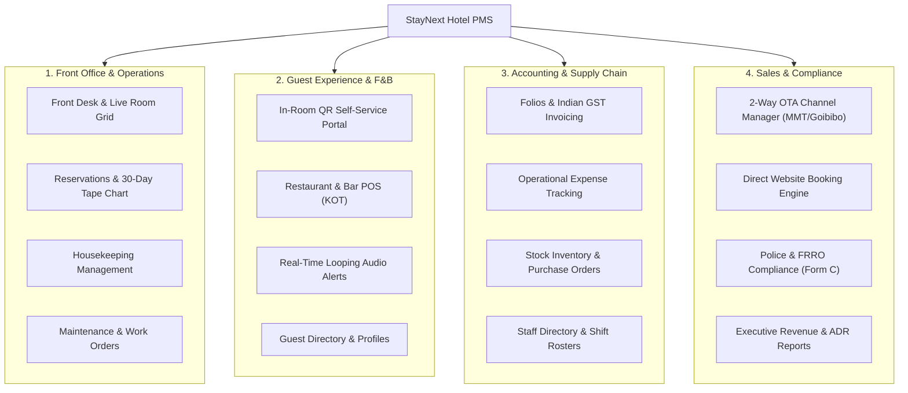

# StayNext Hotel Management Software — Complete Features & Functionality Guide

## Executive Overview
**StayNext** is an all-in-one, cloud-native **Hotel & Property Management SaaS Platform (PMS)** designed for independent hotels, boutique resorts, and multi-property chains. It unites front desk operations, reservations, contactless guest QR services, restaurant POS, housekeeping, maintenance, billing & GST invoicing, corporate sales, inventory, compliance, and multi-channel OTA distribution into a single modern dashboard.

---

---

## 1. Dashboard & Executive Analytics (`/dashboard`)
The central command center providing live hotel performance metrics and instant operational access.

- **Real-Time Key Performance Indicators (KPIs)**:
  - **RevPAR** (Revenue Per Available Room): Calculated live from confirmed bookings.
  - **ADR** (Average Daily Rate): Average rental income per occupied room.
  - **Occupancy Rate (%)**: Real-time ratio of occupied rooms vs total inventory.
  - **Total Revenue**: Aggregate income across rooms, restaurant, and add-on services.
  - **Today's Movement**: Quick counter for expected arrivals, departures, and in-house guests.
- **Quick Action Center**: 1-click modal triggers to create new reservations, execute walk-in check-ins, record maintenance issues, or log direct expenses.
- **Live Activity Feed**: Real-time event log of check-ins, check-outs, room service orders, and maintenance requests.

---

## 2. Front Desk Operations (`/front-desk`)
Streamlined interface for front-office receptionists and duty managers to handle day-to-day guest movement.

- **Live Room Grid Matrix**: Visual cards representing every room on the property, color-coded by occupancy and cleanliness:
  - *Clean & Vacant* (Ready for check-in)
  - *Occupied* (Guest in-house)
  - *Dirty / Turnover Pending* (Awaiting housekeeping)
  - *Inspected / Quality Checked* (Approved by supervisor)
  - *Out of Order / Maintenance Hold* (Blocked)
- **Today's Arrivals Board**: List of expected guest check-ins with booking source, ETA, room type, and advance payment status.
- **Today's Departures Board**: List of guests scheduled for check-out with pending folio balances and key handover verification.
- **1-Click Quick Check-in & Check-out**: Complete check-in in under 15 seconds: allocate room, verify ID proof, collect advance, and issue digital key card.
- **Walk-in Booking Engine**: Immediate reservation creation and room assignment for unannounced walk-in guests.

---

## 3. Reservations & Tape Chart Calendar (`/reservations`)
Comprehensive reservation management with an interactive timeline matrix.

- **Interactive Tape Chart / Gantt Calendar (`/reservations/calendar`)**:
  - 7-day and 30-day continuous timeline showing all rooms vs calendar dates.
  - Color-coded booking bars indicating reservation status.
  - Drag-and-drop room reallocation or stay extension.
- **Multi-Step Reservation Engine (`/reservations/new`)**:
  - Guest selection or instant new guest creation.
  - Room type selection with live availability check.
  - Rate plan selection (EP: Room only, CP: with Breakfast, MAP: Breakfast + Dinner, AP: All meals).
  - Advance deposit recording (Cash, Card, UPI, Online).
  - Special requests capturing (Early check-in, honeymoon setup, airport shuttle).
- **Reservation Lifecycle Management**: Track bookings through confirmed, checked-in, checked-out, cancelled, and no-show states.
- **Search & Filtering**: Instant search by guest name, reservation number, mobile number, or date range, with CSV export.

---

## 4. Property & Room Inventory Hierarchy (`/properties` & `/rooms`)
Granular management of physical hotel structure and accommodation tiers.

- **Multi-Property Switcher**: Manage multiple hotels, resorts, or apartment complexes within a single SaaS account.
- **Physical Hierarchy**: `Property -> Buildings -> Floors -> Rooms`.
- **Room Types Setup (`/rooms/types`)**:
  - Configure categories (Deluxe Room, Executive Suite, Family Villa, Dormitory).
  - Base occupancy, maximum occupancy, and extra bed / child charges.
  - Default base rates and amenities checklist.
- **Visual Floor Plans (`/rooms/floor-plan`)**: Floor-by-floor interactive floor plan allowing front desk and housekeeping to view room placement.
- **Room Blocking Management (`/rooms/blocking`)**:
  - Lock rooms out of inventory for scheduled renovations, deep cleaning, or emergency repairs.
  - Automatically prevents overbooking on the direct booking engine and OTAs during maintenance periods.
- **Room QR Code Generator (`/rooms/qr-codes`)**:
  - Generates secure, cryptographic QR codes for every room.
  - Printable sheet generator supporting **1, 2, 4, or 8 QR cards per page**.
  - One-click PNG and SVG export for acrylic standee printing.

---

## 5. Contactless Guest QR Self-Service Experience
Empowers in-house guests to access hotel services from their own smartphones without downloading an app.

- **Guest Portal (`/guest/[propertyId]/[roomId]`)**:
  - Scanning the in-room QR code opens a mobile-optimized web app authenticated to their room.
  - Shows guest name, room number, Wi-Fi password, and hotel contact details.
- **In-Room Dining (F&B Ordering)**:
  - Digital menu catalog categorized by Breakfast, Starters, Main Course, Desserts, and Beverages.
  - Dietary filter toggles: **Veg**, **Non-Veg**, and **Chef's Special**.
  - Item modifiers (Spice level, cooking instructions).
  - Real-time cart calculation with automated room folio billing or cash on delivery.
- **Housekeeping & Amenities Requests**:
  - Guest can request extra towels, water bottles, toiletries, room cleaning, or laundry pickup.
  - **Media Attachment**: Guests can attach photos or voice notes (uploaded directly to ImageKit CDN).
- **Maintenance Reporting**: Guests can report issues (AC not cooling, geyser problem, TV issue) with priority flags.
- **Live Order & Request Tracker (`/guest/track/[token]`)**:
  - Real-time order progress timeline: *Order Placed -> Kitchen Preparing -> Out for Delivery -> Delivered*.
  - Star rating and feedback submission upon service completion.

---

## 6. Real-Time Notification & Looping Audio Alert System
Ensures hotel staff never miss a guest request, housekeeping task, or food order.

- **Continuous Looping Sound Alarm**: When a guest submits a food order, housekeeping request, or maintenance ticket via QR code, the software plays an audible alert that loops continuously until acknowledged.
- **Top Header Bell Icon & Popover**:
  - Counter badge displays total unread requests in real time.
  - Clicking the bell opens a sleek popover displaying all recent requests across Housekeeping, Maintenance, and F&B.
- **Color Shaded Notification Cards**:
  - **Unread Requests**: Highlighted with an alert-colored shade card to demand immediate attention.
  - **Read / Acknowledged Requests**: Soft neutral shade card indicating the request has been reviewed.
- **1-Click Acknowledge**: Clicking "OK" or "View Request" silences the alarm and updates the status across all connected staff terminals.

---

## 7. Restaurant & Point of Sale (POS) (`/restaurant`)
Complete food and beverage management for hotel restaurants, room service, cafes, and banquet dining.

- **Table Management & Floor Seating (`/restaurant/tables`)**: Visual layout of restaurant tables with statuses (*Available, Seated, Dining, Billing*).
- **Kitchen Order Ticket (KOT) Dispatch**:
  - Generates digital and printable Kitchen Order Tickets with table/room number, items, quantities, and special notes.
  - Instant dispatch to kitchen display terminals.
- **Digital Menu & Category Catalog (`/restaurant/menu`)**: Manage dishes, prices, tax rates (5% GST for F&B), and 1-click in-stock / out-of-stock toggles.
- **Flexible Bill Settlement**:
  - Direct payment settlement via Cash, Credit Card, or UPI.
  - **Transfer to Room Bill**: 1-click transfer of F&B charges directly into the guest's hotel room folio to settle upon checkout.
- **F&B Analytics (`/restaurant/reports`)**: F&B revenue breakdown, most popular dishes, average table turnaround time, and daily food sales.

---

## 8. Housekeeping Management (`/housekeeping`)
Organized room turnover and sanitation tracking.

- **Housekeeping Board**: Real-time room status tracking (*Dirty -> In Progress -> Clean -> Inspected*).
- **Staff Task Scheduling (`/housekeeping/schedule`)**: Assign cleaning attendants to specific floors or room blocks.
- **Configurable Cleaning Types (`/housekeeping/types`)**: Daily stayover cleaning, checkout deep sanitation, VIP arrival preparation, or linen change.
- **Productivity Reporting (`/housekeeping/reports`)**: Average room cleaning duration and staff turnover efficiency.

---

## 9. Maintenance & Engineering (`/maintenance`)
Preventative and corrective equipment upkeep.

- **Work Order Management**: Log maintenance issues with description, location, affected room, and assigned technician.
- **Priority Matrix**: Low, Medium, High, and Emergency severity flags.
- **Automated Room Lock**: Logging high/emergency tickets can automatically block the room from inventory.
- **Resolution & Vendor Tracking**: Record repair costs, spare parts used, resolution notes, and vendor receipts.

---

## 10. Billing, Invoicing & GST Accounting (`/billing`)
Robust financial ledger and Indian statutory tax compliance.

- **Guest Folio Management**: Real-time itemized ledger showing room charges, restaurant bills, laundry, paid advances, and pending balance.
- **Split Folio Capability**: Split charges between personal folio and corporate/company accounts.
- **Official Indian GST Tax Invoice (`/billing/invoices/[id]`)**:
  - Compliant with Indian Goods and Services Tax (GST) rules.
  - Supports **SAC Code 9963** (Accommodation Services).
  - Automated 12% GST (6% CGST + 6% SGST) or 18% GST calculation based on room tariff slabs.
  - Formatted for official hotel letterhead with `window.print()` support.
- **Payment Gateway & Ledger (`/billing/payments`)**: Record multi-mode payments (Cash, Credit/Debit Card, UPI, Bank NEFT/RTGS).

---

## 11. Operational Expense Management (`/expenses`)
Full control over hotel operational expenditure.

- **Expense Tracking**: Log expenses with date, category, amount, vendor name, payment method, and tax deductions.
- **Dynamic Dropdown Creation**: Add custom expense categories on the fly directly inside the expense creation form without leaving the page.
- **Budget Monitoring (`/expenses/categories`)**: Category budget caps with real-time visual progress bars against current spending.

---

## 12. Inventory & Supply Chain (`/inventory`)
Centralized stock control for hotel consumables and operating equipment.

- **Stock Tracking**: Monitor inventory for guest amenities, toiletries, bed linen, kitchen ingredients, and cleaning chemicals.
- **Low Stock Automated Alerts**: Visual warning indicators when item counts fall below minimum re-order thresholds.
- **Vendor Directory (`/inventory/suppliers`)**: Manage supplier contacts, GST numbers, payment terms, and historical deliveries.
- **Purchase Orders (POs) (`/inventory/purchase-orders`)**: Draft, approve, and track purchase orders from vendor dispatch to store receipt.

---

## 13. Employees & Human Resources (`/employees`)
Workforce management and role-based staff scheduling.

- **Staff Directory (`/employees`)**: Profile records with designation, department, contact info, salary, and emergency contacts.
- **Departments Setup (`/employees/departments`)**: Organize teams into Front Office, Housekeeping, Kitchen, F&B Service, Maintenance, Security, and Accounts.
- **Shift Rostering (`/employees/schedules`)**: Plan morning, evening, and night shifts with weekly off assignments.
- **Role-Based Access Control (RBAC)**: Fine-grained permissions restricting sensitive billing and audit data to authorized managers.

---

## 14. Rates & Revenue Management (`/rates`)
Dynamic rate setting to optimize hotel occupancy and RevPAR.

- **Rate Plans (`/rates`)**: Configure Room Only (EP), Continental Plan (CP), Modified American Plan (MAP), and American Plan (AP).
- **Seasonal Pricing Calendar (`/rates/seasonal`)**: Set automatic percentage or flat rate multipliers for Peak Season, Holidays, and Off-Peak periods.
- **Promotions & Promo Codes (`/rates/promotions`)**: Create promo codes with percentage discounts, validity date windows, and minimum stay requirements.

---

## 15. Corporate Accounts & Travel Agents (`/corporate`)
B2B relationship management for corporate travel and travel agent commissions.

- **Corporate Accounts**: Manage company profiles, billing addresses, credit limits, and payment cycles (Net 15 / Net 30).
- **Corporate Negotiated Contracts (`/corporate/contracts`)**: Lock special corporate room rates for contracted corporate entities.
- **Travel Agent Directory (`/corporate/travel-agents`)**: Manage OTA partners and offline travel agents with commission tracking.

---

## 16. Legal & Police Compliance (`/compliance`)
Statutory recordkeeping and regulatory compliance for hospitality operations.

- **Form C / Foreign Guest Registration (`/compliance/foreign-guests`)**: Capture passport numbers, visa details, port of entry, and arrival/departure dates for FRRO compliance.
- **Form III Inspection Register (`/compliance/form-iii`)**: Statutory register for local administrative audits.
- **Police Guest Register (`/compliance/guest-register`)**: Digital police register with guest photo identification and address proofs.
- **Hotel Licenses & Permits Tracker (`/compliance/licences`)**: Track fire safety permits, trade licenses, liquor licenses, and health clearances with expiry alerts.
- **Audit Logs (`/compliance/audit-logs`)**: Immutable timestamped trail recording every reservation creation, rate override, and invoice cancellation.

---

## 17. Reports & Business Intelligence (`/reports`)
Actionable executive reporting and financial analytics.

- **Financial & Revenue Reports (`/reports/financial` & `/reports/revenue`)**: Daily, monthly, and yearly revenue broken down by room rent, F&B, and services.
- **Occupancy Reports (`/reports/occupancy`)**: Track room nights sold, occupancy percentage, RevPAR, and ADR trends over time.
- **Guest Demographics (`/reports/guests`)**: Analyze guest origin cities, nationalities, repeat guest ratios, and channel sources.
- **Exporting**: Instant CSV download for spreadsheets and accounting software.

---

## 18. OTA Channel Manager & Booking Engine (`/booking-engine`)
Integrated distribution engine connecting your hotel with the global travel marketplace.

- **Direct Booking Engine (`/booking-engine`)**: Mobile-friendly direct booking engine embeddable on hotel websites with zero commission.
- **2-Way ZimmerStack Channel Manager (`/booking-engine/channels`)**:
  - Live 2-way sync with **MakeMyTrip (IngoMMT)**, **Goibibo**, **Booking.com**, **Agoda**, and **Airbnb**.
  - Automatic room availability decrement on all OTAs upon check-in.
  - Automatic reservation ingestion via inbound webhooks directly into the PMS.
  - **Company Master Account Support**: Seamlessly driven via environment configuration (`.env`).

---

## 19. Third-Party Integrations & Settings (`/settings`)
Connectivity with external enterprise APIs.

- **Meta WhatsApp Cloud API**: Automated guest notifications:
  - Instant booking confirmation messages with reservation details.
  - Pre-arrival check-in information and directions.
  - Post-checkout thank you message and review request.
- **ImageKit CDN Storage**: High-performance real-time media CDN for storing guest housekeeping and maintenance photo/audio uploads.
- **Company Branding & Hotel Info**: Set logo, property address, contact details, check-in/out times, and GST tax percentages.
- **Subscription & Onboarding Protection**: Active subscription gating ensuring expired or inactive accounts are guided through renewal.

---

## 20. UX & Usability Design Standards
Enforced across every single screen in StayNext:

- **Clean Number Inputs**: Universal suppression of browser stepper up/down arrows; scroll-wheel increments disabled to prevent accidental value alterations; inputs initialize empty for manual typing.
- **Design System**: Sora typography, signature `#5e2b9d` primary palette, max 6px border radius, and full cursor pointer interactivity.
- **Collapsible Sidebar**: Sidebar cleanly collapses to 0 width, allowing tables and Gantt charts to occupy 100% full-screen width.
- **Strict Multi-Tenant Isolation**: Zero cross-tenant data leakage; every query is securely partitioned by tenant and property ID.
